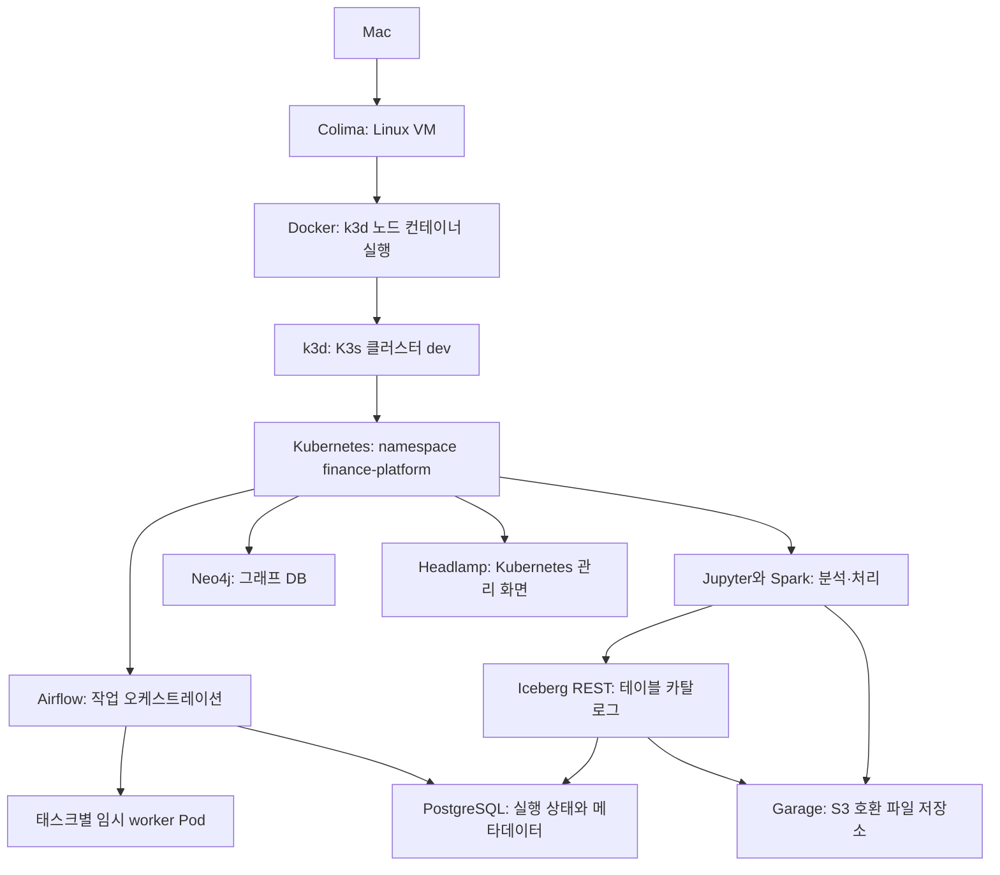

# 내 데이터 플랫폼으로 배우는 Kubernetes와 Airflow

이 문서는 추상적인 설치 예제 대신 **현재 이 프로젝트에서 실행 중인 구성**을
기준으로 작성한 개인 학습 자료다. 확인 기준일은 **2026-11-13**이다.
학습 문서를 작성하면서 서비스를 재시작하거나 설정을 변경하지 않았다.

## 먼저 전체 그림 보기



Docker와 Kubernetes는 여기서 서로 다른 층이다. Docker가 k3d의 노드 컨테이너를
실행하고, 노드 안의 K3s는 containerd로 애플리케이션 컨테이너를 실행한다.

## 추천 학습 순서

| 순서 | 읽을 문서 | 이 단계에서 답할 질문 |
| --- | --- | --- |
| 1 | [Colima](colima/README.md) → [Docker](docker/README.md) → [k3d](k3d/README.md) | Mac에서 Linux Kubernetes가 어떻게 실행되는가? |
| 2 | [Kubernetes 기본](kubernetes/README.md) | Pod, Deployment, StatefulSet은 무엇이 다른가? |
| 3 | [네트워크](kubernetes/02-networking.md) → [저장소·권한](kubernetes/03-storage-and-security.md) | 이름으로 접속하고 데이터·권한을 유지하는 방법은? |
| 4 | [Airflow 구조](airflow/README.md) → [현재 설정](airflow/02-configuration.md) | Airflow의 각 Pod는 무슨 일을 하는가? |
| 5 | [KubernetesExecutor](airflow/03-kubernetes-executor.md) → [DAG 실습](airflow/04-dags-and-practice.md) | 태스크 하나가 어떤 경로로 실행되는가? |
| 6 | [Triggerer](airflow/05-triggerer.md) → [운영·복구](airflow/06-operations.md) | 기다리는 작업과 장애는 어떻게 다루는가? |
| 7 | [Traefik](traefik/README.md) → [Tailscale](tailscale/README.md) → [Headlamp](headlamp/README.md) | 브라우저에서 Pod까지 요청이 어떻게 전달되는가? |
| 8 | [PostgreSQL](postgresql/README.md) → [Garage](garage/README.md) → [Iceberg](iceberg/README.md) | DB, 파일 저장소, 테이블 포맷의 차이는? |
| 9 | [Jupyter](jupyter/README.md) → [Spark](spark/README.md) → [Neo4j](neo4j/README.md) | 분석·처리·그래프 저장을 어떻게 연결하는가? |
| 필요할 때 | [Kubernetes 장애 진단](kubernetes/04-troubleshooting.md) | 상태와 이벤트를 어떤 순서로 읽는가? |

## 현재 실행 상태 요약

| 항목 | 실제 확인한 구성 |
| --- | --- |
| 실행 기반 | Colima, ARM64, CPU 2개, 메모리 24GiB, 디스크 100GiB |
| Kubernetes | K3s `v1.35.5+k3s1`, 단일 노드 `k3d-dev-server-0`, Ready |
| Context / namespace | `k3d-dev` / `finance-platform` |
| Airflow | 3.0.2, chart 1.18.0, Kubernetes provider 10.24.0 |
| Executor | `KubernetesExecutor`, 동시 실행 한도 2 |
| Airflow 상주 Pod | API server / DAG processor / scheduler 각각 1개 |
| Triggerer | 비활성화 |
| 플랫폼 상주 Pod | 총 9개, 조회 시 모두 Running / Ready 1/1 |
| 작업 Pod | 태스크 실행 때 생성하고 성공하면 삭제 |
| DAG / 로그 | 각각 1Gi / 2Gi PVC, local-path, ReadWriteOnce |
| 나머지 데이터 PVC | PostgreSQL·Garage·Neo4j 각 10Gi, Jupyter 2Gi |

현재 9개 Pod는 Airflow 3개와 Garage, Headlamp, Iceberg REST, Jupyter, Neo4j,
PostgreSQL이다. CoreDNS 등 `kube-system`의 Pod는 이 9개에 포함하지 않는다.
시스템 namespace의 전체 실시간 목록은 이번 조회 환경에서 권한 제한으로 확인하지
못했으므로, 시스템 Pod의 현재 개수나 정상 여부를 단정하지 않는다.

`bronze-to-silver`, `silver-to-gold` Deployment는 **replicas=0**이다.
기사 수집·실제 Gemini 호출·Kafka 적재가 상시 가동 중이라는 뜻은 아니다.
Kafka/Strimzi/Connect는 설정 준비와 실제 기동을 구분해서 읽는다.

## 문서 읽는 규칙

각 도구 문서는 개념, 현재 값, 설정 위치, 실습, 확인 문제를 연결한다.
`현재 확인`은 API나 실행 중 컨테이너에서 읽은 값이다. `설정 파일`은 저장소의
선언이며 아직 적용되지 않은 내용을 포함할 수 있다. `변경 예시`는 학습용 절차로,
문서 작성 중 실행하지 않았다.

실습은 기본적으로 조회만 한다. 업그레이드·DAG 업로드·태스크 실행 예시는 상태를
바꾸므로 구분해 표시했다. 기존 PVC·namespace·클러스터를 삭제하는 실습은 없다.

공개 저장소이므로 개인 Tailnet 호스트·IP·로컬 사용자 경로·비밀번호·토큰은
싣지 않았다. `<AIRFLOW_HOST>`, `<HEADLAMP_HOST>`, `<PROJECT_ROOT>`는 자신의
환경 값으로 바꾸는 자리다. 서비스 이름 `postgres`, `garage` 등은 설명에 필요한
클러스터 내부 DNS 이름이다.

## 재배포 전에 꼭 이해할 차이

2026-11-13 Airflow executor와 Headlamp 인증은 **kubectl로 실제 변경**했다.
로컬 설정 파일은 변경했지만 **Helm release 기록은 이전 설정**을 담고 있다.
따라서 예전 release 값만 재사용하거나 무작정 rollback하면 최신 구성이 되돌아갈 수 있다.
학습 문서 PR은 문서만 게시하며, 로컬의 미커밋 배포 설정을 자동으로 함께 게시하지 않는다.
GitHub main의 파일과 현재 로컬·실행 상태가 다를 수 있으므로 재배포에는 현행 설정을 사용한다.

로그 PVC는 연결돼 있지만 로그 자동 삭제·보존 기간은 아직 설정하지 않았다.
local-path의 용량 요청은 실제 디스크 quota를 보장하지 않는다.
단일 노드 구성은 고가용성 또는 백업을 제공하지 않는다.

## 근거와 다시 확인하기

주요 근거는 현재 노드·워크로드·PVC 조회, Airflow 설정 whitelist 조회,
`deploy/k8s/helm/airflow/values.yaml`, `configs/spark/spark-defaults.conf`,
각 서비스 manifest와 `configs/runtime/VALIDATION.md`다.
기존 검증 문서에는 2026-10-18 최초 설치 기록이 있으므로 현재 상태와 날짜를 구분한다.

```sh
kubectl --context k3d-dev get nodes -o wide
kubectl --context k3d-dev -n finance-platform get pods
kubectl --context k3d-dev -n finance-platform get deploy,sts,svc,pvc,ingress
kubectl --context k3d-dev -n finance-platform exec deployment/airflow-scheduler \
  -c scheduler -- airflow config get-value core executor
```

다 읽은 뒤에는 **브라우저 요청 하나와 Airflow 태스크 하나의 경로를 각각 직접
그릴 수 있는지** 확인해 보자. 두 경로를 설명할 수 있으면 플랫폼의 핵심 구조를
이해한 것이다.
