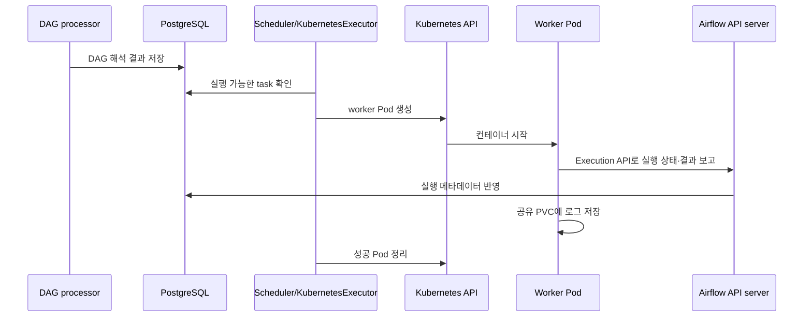

# Airflow 구조: 설정 참고 자료

> **설정 참고 자료** — 처음 공부한다면 [전체 목차](../README.md)의 본문을 먼저 읽는다.
> 관련 본문: [18장](../chapters/18-airflow-concepts.md) · [20장](../chapters/20-airflow-on-kubernetes.md). 아래의 실행 상태·검증 결과는 기존 작성 당시의 기록이며,
> 2026-11-14 재구성 과정에서 클러스터를 새로 조회한 결과가 아니다.

2026-11-24 기준 Airflow는 현재 새 환경에 미배포 상태다. 아래 Pod 수와 조회 명령은 이전 `finance-platform` 구성 기준이다.
현재 클러스터 조회 방법은 [루트 README](../../../README.md)를 참고한다.

## 학습 목표

웹 화면, DAG 해석, 스케줄링, 태스크 실행을 서로 다른 역할로 이해한다.

## 이전 환경의 구성

Airflow **3.0.2**, Helm chart **1.18.0**, Kubernetes provider **10.24.0**을 사용한다.
저장소의 executor 설정은 `KubernetesExecutor`다. 고정 worker Deployment나 Celery broker는 없다.

| 컴포넌트 | 이전 Pod 구성 | 역할 |
| --- | --- | --- |
| API server | 1 | 웹 UI·API·태스크 Execution API 제공 |
| DAG processor | 1 | DAG Python 파일을 읽고 DB에 구조·버전 정보 반영 |
| Scheduler | 1 | 실행할 태스크를 정하고 KubernetesExecutor로 Pod 요청 |
| Worker | 태스크마다 생성 | 태스크 실행 후 종료 |
| Triggerer | 0 | 현재 비활성화, deferrable 작업 대기용 |
| PostgreSQL | 별도 StatefulSet 1 | Airflow 메타데이터 DB `airflow_meta` |



Airflow 3에서는 태스크가 Execution API를 사용한다는 점이 중요하다.
이전 환경의 실행 API 주소는 `http://airflow-api-server:8080/execution/`다.
현재 worker template에는 기존 DB 등 Secret 참조도 있지만, 역할을 이해할 때
태스크 실행 통신과 scheduler의 메타데이터 DB 사용을 구분한다.

## 왜 Pod가 3개만 보이는가?

대기 중인 태스크가 없으면 API server, DAG processor, scheduler만 남는다.
작업을 실행할 때 worker Pod가 생기고 성공하면 삭제된다.
따라서 "worker Pod가 없다"와 "executor가 동작하지 않는다"는 같은 말이 아니다.

## 읽어 볼 실제 설정

- `deploy/k8s/helm/airflow/values.yaml`: 현재 로컬 선언.
- `deploy/k8s/helm/airflow/executor-resources.yaml`: worker 신원·RBAC·PVC.
- `docker/airflow/Dockerfile`: Airflow/provider 이미지.
- ConfigMap `airflow-config`: 실제 컨테이너의 설정과 Pod template.

파일은 프로젝트 루트를 기준으로 한다. 저장소 선언과 실제 실행 설정은 대조해서 읽는다.

## 조회 실습

```sh
kubectl --context k3d-dev -n finance-platform get pods -l release=airflow
kubectl --context k3d-dev -n finance-platform exec deployment/airflow-scheduler \
  -c scheduler -- airflow version
kubectl --context k3d-dev -n finance-platform exec deployment/airflow-scheduler \
  -c scheduler -- airflow config get-value core executor
```

## 확인 문제

1. DAG processor와 scheduler는 각각 무엇을 결정하는가?
2. Worker Pod가 삭제된 뒤 실행 성공 여부는 어디에서 확인하는가?

**해설:** 전자는 DAG 파일의 구조를 해석하고, 후자는 실행할 태스크를 배정한다.
성공 여부는 Airflow UI/메타데이터 DB에 남으며 현재 로그는 공유 PVC에 보존된다.

다른 참고 자료: [설정값](02-configuration.md), [KubernetesExecutor](03-kubernetes-executor.md),
[DAG 실습](04-dags-and-practice.md), [Triggerer](05-triggerer.md),
[운영·복구](06-operations.md).
