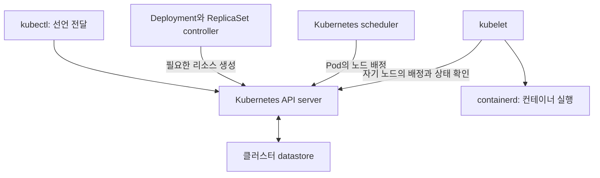

# 6장. K3s 내부: 결정하는 쪽과 실행하는 쪽

## 왜 필요한가

“Kubernetes가 Pod를 실행한다”를 풀어 보면 설정 접수, 상태 기록, Pod 생성,
노드 선택, 컨테이너 실행으로 나뉜다. 역할을 알면 장애가 난 단계도 좁힐 수 있다.

## 어떻게 동작하는가

**제어 평면(control plane)**은 클러스터 상태를 관리하고 필요한 결정을 내린다.
**노드 실행 구성 요소**는 배정된 Pod를 실제로 실행한다. 한 server 노드에 두 역할이
함께 있어도 책임은 구분한다.

| 구성 요소 | 하는 일 |
| --- | --- |
| Kubernetes API server | 리소스 조회·변경 요청 접수, 인증·인가·검증 |
| Datastore | 클러스터 리소스 상태 저장 |
| Controller | 선언한 상태와 현재 상태 차이를 줄이는 제어 반복 |
| Kubernetes scheduler | 아직 노드가 없는 Pod의 배치 노드 선택 |
| kubelet | 자기 노드에 배정된 Pod의 실행·상태 관리 |
| containerd | 이미지와 컨테이너 실행 관리 |
| CNI 네트워크 플러그인 | Pod 네트워크 구성 |
| kube-proxy 등 Service 네트워크 구현 | Service 주소로 온 연결을 endpoint로 전달하는 규칙 관리 |

**인증**은 누구인지 확인하는 것이고 **인가**는 그 신원에 작업 권한이 있는지
확인하는 것이다. 구체적인 권한 구성은 14장에서 다룬다.

Deployment가 앱 1개를 요구할 때의 논리적 관계는 다음과 같다. 구성 요소들은
한 줄로 직접 호출하기보다 API로 상태를 읽고 갱신한다.



Controller는 API 상태를 관찰하며 필요한 변경을 반복한다. 원하는 상태로 맞추는
이 과정을 **reconciliation**이라고 한다. 따라서 API 요청 성공과 앱 실행 완료는 다르다.

Kubelet은 “지금 이 노드에서 실행돼야 할 Pod”와 실제 컨테이너 상태를 비교한다.
containerd와는 **CRI**라는 컨테이너 실행 인터페이스를 통해 통신한다. 네트워크
준비에는 CNI 플러그인이 관여한다. kubelet·CRI·CNI는 같은 프로그램의 다른 이름이 아니다.

K3s가 기본 제공하는 Flannel은 Pod 간 통신 네트워크를, CoreDNS는 이름 해석을,
Traefik은 HTTP 진입을 맡는다. 시스템 도구가 함께 설치돼도 제어 평면의 scheduler나
노드 실행 관리자인 kubelet과 책임이 다르다. 자세한 요청 경로는 11–12장에서 연결한다.

### 상태 저장소 두 종류를 구분하기

일반적인 Kubernetes 설명에는 etcd가 등장한다. K3s는 구성에 따라 embedded
SQLite, embedded etcd, 외부 datastore 등을 사용한다. 단일 server 기본값과
실제 구성을 혼동하지 않는다. **현재 클러스터의 datastore 종류는 이번에 조회하지
않았으므로 SQLite나 etcd라고 확정하지 않는다.**

앱 PostgreSQL의 `airflow_meta`는 Airflow 실행 기록 DB다. 이것을 사용한다고
Kubernetes의 datastore까지 그 PostgreSQL이라는 뜻은 아니다.

## 우리 프로젝트에서는

[Jupyter 선언](../../../deploy/k8s/manifests/spark/jupyter.yaml)의
`spec.replicas: 1`은 유지할 목표다. Deployment/ReplicaSet controller가 Pod를
만들고 scheduler가 노드를 정하며 kubelet/runtime이 실행한다.

K3s는 여러 제어 구성 요소를 통합해 실행하므로 각각이 독립 Pod로 보일 것이라고
가정하면 안 된다. 시스템 Pod 목록에 API server가 없다는 이유만으로 없는 것은 아니다.

## 직접 확인하기

```sh
kubectl --context k3d-dev get nodes -o wide
kubectl --context k3d-dev -n finance-platform get pods -o wide
kubectl --context k3d-dev -n kube-system get pods
```

첫 출력의 runtime과 둘째 출력의 NODE 열을 연결한다. 셋째는 권한이 있을 때
CoreDNS·Traefik 같은 시스템 보조 앱을 찾는다. 설치 옵션에 따라 목록이 다르며,
이 명령이 K3s의 모든 내부 프로세스를 나열하는 것은 아니다.

## 이해 확인

1. 노드를 선택하는 주체와 노드에서 실행을 관리하는 주체는?
2. DAG 성공 기록과 Deployment replica 수는 같은 시스템의 상태인가?

**해설:** Kubernetes scheduler와 kubelet이다. DAG 기록은 Airflow 메타데이터이고
Deployment 상태는 Kubernetes 리소스다. 상위 앱과 그 실행 기반의 상태를 나누어 본다.

근거: [Kubernetes 구성 요소](https://kubernetes.io/docs/concepts/overview/components/),
[K3s 아키텍처](https://docs.k3s.io/architecture).

---

[전체 목차](../README.md) · [이전: 5장. k3d 클러스터의 server·agent·serverlb](05-k3d-cluster.md) · [다음: 7장. YAML 선언에서 Pod 실행까지](07-declaration-to-pod.md)
