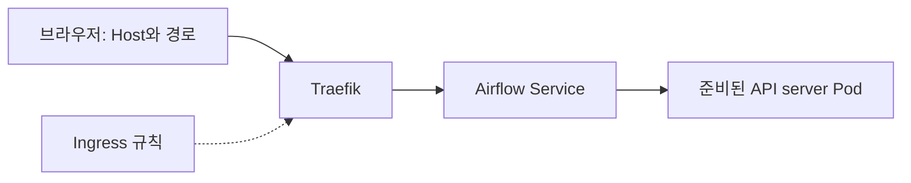

# 12장. Service·DNS·Ingress로 요청 따라가기

## 왜 필요한가

Pod IP는 교체 시 바뀔 수 있다. DB 주소에 Pod IP를 직접 적어 두면 연결이 깨진다.
안정된 접속점과 이름 해석, HTTP 라우팅을 나누어 이해하자.

## 어떻게 동작하는가

**Service**는 앱에 접근할 안정된 접속점을 제공한다. 흔한 selector 기반 Service는
label 조건에 맞는 Pod를 대상으로 삼고, EndpointSlice에 실제 endpoint 정보를 관리한다.
일반적인 트래픽에서는 준비된 endpoint로 전달된다.

ClusterIP Service마다 별도 프록시 Pod가 하나씩 생기는 것은 아니다. 기본적인
구성에서는 kube-proxy가 노드의 전달 규칙을 관리한다. 네트워크 구현에 따라 방식은
달라질 수 있다. Service 객체, DNS, 실제 패킷 전달을 서로 다른 책임으로 읽는다.

**CoreDNS**는 클러스터의 DNS 서버다. 이름을 IP로 바꿔 준다.
같은 namespace의 Pod는 `postgres`, 다른 namespace에서는
`postgres.finance-platform.svc.cluster.local` 같은 이름을 사용할 수 있다.
`cluster.local`은 일반적인 클러스터 도메인이고 설치 시 달라질 수 있다.
DNS는 비밀번호 검사나 DB 정상 실행을 대신하지 않는다.

**Ingress**는 HTTP Host·경로에 맞춰 Service를 선택하는 선언이다.
**Ingress controller**인 Traefik이 그 선언을 읽고 실제 요청을 전달한다.
Ingress 객체만 있고 controller가 없으면 요청을 처리할 주체가 없다.



## 우리 프로젝트에서는

[platform-ui](../../../deploy/k8s/manifests/ingress/platform-ui.yaml)는
Airflow와 Jupyter의 Host를 구분한다. Airflow Service 포트는 8080이다.
Jupyter는 [선언](../../../deploy/k8s/manifests/spark/jupyter.yaml)에서
Service `port: 8888`을 컨테이너의 이름 붙인 `targetPort: http`로 연결한다.
port와 targetPort는 같을 수도 다를 수도 있다.

Tailscale 원격 접속은 이 앞에 HTTPS·네트워크 경로를 추가한다.
자세한 구성은 [Tailscale 참고 자료](../tailscale/README.md)에 있다.

## 직접 확인하기

```sh
kubectl --context k3d-dev -n finance-platform get service airflow-api-server
kubectl --context k3d-dev -n finance-platform get endpointslice \
  -l kubernetes.io/service-name=airflow-api-server
kubectl --context k3d-dev -n finance-platform get ingress
kubectl --context k3d-dev -n finance-platform \
  port-forward service/airflow-api-server 18080:8080
```

첫 명령은 접속점, 둘째는 연결할 실제 endpoint, 셋째는 HTTP 규칙을 본다.
마지막은 **임시 연결**이다. `18080:8080`은 Mac의 18080에서 Service의 8080으로
연결한다. 터미널을 유지하고 `http://127.0.0.1:18080`을 연 뒤 `Ctrl+C`로 종료한다.
port-forward는 Ingress 경로를 거치지 않지만 앱 자체 로그인은 여전히 필요하다.

예상 결과는 UI 응답이나 로그인 화면이다. 여기서는 되는데 외부 주소에서 실패하면
앱 앞의 Host·포트 전달·Ingress·Tailscale 경로로 조사 범위를 옮긴다.

## 이해 확인

1. Service가 있는데 endpoint가 비어 있으면 무엇을 볼까?
2. DNS 조회가 되면 DB 로그인도 성공했다고 말할 수 있는가?

**해설:** selector와 Pod label, Pod 준비 상태를 본다. DNS는 이름 해석만 검증하므로
앱 연결·인증 성공은 따로 확인해야 한다.

근거: [Service](https://kubernetes.io/docs/concepts/services-networking/service/),
[Ingress](https://kubernetes.io/docs/concepts/services-networking/ingress/).

---

[전체 목차](../README.md) · [이전: 11장. Mac·VM·노드·Pod의 네트워크 경계](11-network-boundaries.md) · [다음: 13장. 볼륨·PV·PVC와 실제 데이터 위치](13-storage.md)
