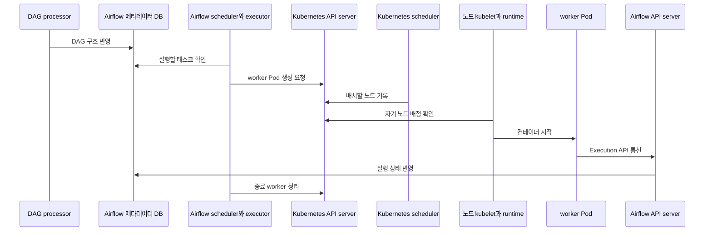

# 20장. 두 scheduler와 태스크별 worker Pod

## 왜 필요한가

앞 장의 태스크를 실행하면 누가 worker를 만들고 어디에 배치할까?
여기에는 **Airflow scheduler**와 **Kubernetes scheduler**가 둘 다 관여한다.

## 어떻게 동작하는가

| 구성 요소 | 결정·역할 | 관리하는 대상 |
| --- | --- | --- |
| DAG processor | Python 파일을 읽고 DAG 구조를 반영 | 작업 정의 |
| Airflow scheduler | 실행 시점·의존성·동시성을 고려해 태스크 배정 | Task Instance |
| KubernetesExecutor | scheduler의 실행 방식으로 worker Pod 생성·관찰 | 태스크 실행 Pod |
| Kubernetes scheduler | 미배정 Pod를 실행할 노드 선택 | Pod의 node 배정 |
| kubelet/containerd | 배정된 Pod의 컨테이너 실행 | 노드의 실행 프로세스 |
| Airflow API server | UI·API·태스크 Execution API 제공 | Airflow 요청·실행 상태 |

KubernetesExecutor는 별도 상주 Deployment가 아니라 scheduler가 사용하는 실행 방식이다.
worker는 작업을 실제 수행하는 Pod다. 현재처럼 작업이 없을 때 worker가 없는 것은 정상이다.



worker 생성에는 scheduler의 Kubernetes 권한, 실행 이미지, DAG 파일, 볼륨,
Airflow API 연결이 필요하다. 단순히 executor 이름만 바꾸는 것으로 완성되지 않는다.
worker가 종료돼도 실행 상태는 DB에 남고 현재 로그는 공유 PVC에 남는다.

**Operator**와 **Executor**도 구분한다. Python 태스크는 worker에서 Python을 실행한다.
KubernetesJobOperator는 worker에서 operator 코드가 실행된 뒤 별도 Job을 만들 수 있다.
이 경우 업무 Pod가 추가될 수 있지만 모든 태스크가 반드시 이중 Pod 구조인 것은 아니다.

## 우리 프로젝트에서는

[values](../../../deploy/k8s/helm/airflow/values.yaml)는 KubernetesExecutor,
`parallelism: 2`, 실행 namespace `finance-platform`을 지정한다.
API·scheduler·DAG processor를 상주시킨다. triggerer는 비활성화다.
worker 권한(로컬 파일 `deploy/k8s/helm/airflow/executor-resources.yaml`)은 제한돼
있으므로 기본 worker가 임의의 업무 Job을 만들 수 있는 것은 아니다.

## 직접 확인하기

```sh
kubectl --context k3d-dev -n finance-platform get pods -l release=airflow
kubectl --context k3d-dev -n finance-platform get pods -l component=worker
kubectl --context k3d-dev -n finance-platform exec deployment/airflow-scheduler \
  -c scheduler -- airflow config get-value core executor
```

첫 목록은 상주 구성, 둘째는 현재 worker를 찾는다. 작업이 없거나 성공 worker가
정리됐다면 둘째 결과가 비어 있을 수 있다. 셋째는 컨테이너 환경에서 읽은 실행 방식이다.
과거 검증 결과는 전환 기록(로컬 파일 `configs/airflow/KUBERNETES-EXECUTOR.md`)에 있다.

## 이해 확인

1. 실행 가능한 태스크인데 worker Pod가 Pending이면 어느 scheduler의 문제부터 볼까?
2. 태스크가 실행되지 않고 worker도 없으면 Kubernetes scheduler만 보면 충분한가?

**해설:** worker가 생성됐지만 미배정이면 Kubernetes의 이벤트·배치 조건부터 본다.
worker 생성 전이라면 Airflow의 pause·의존성·동시성·executor 요청 및 권한도 확인해야 한다.

근거: [Airflow 구조](https://airflow.apache.org/docs/apache-airflow/3.0.2/core-concepts/overview.html),
[KubernetesExecutor 소스](https://github.com/apache/airflow/tree/providers-cncf-kubernetes/10.24.0/providers/cncf/kubernetes).

---

[전체 목차](../README.md) · [이전: 19장. 두 작업을 연결하는 첫 DAG](19-first-dag.md) · [다음: 21장. DAG 배포·로그·동시성·대기](21-airflow-operations.md)
