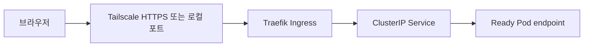

# Kubernetes 참고: Service, CoreDNS, Ingress

> **설정 참고 자료** — 처음 공부한다면 [전체 목차](../README.md)의 본문을 먼저 읽는다.
> 관련 본문: [11장](../chapters/11-network-boundaries.md) · [12장](../chapters/12-services-dns-ingress.md). 아래의 실행 상태·검증 결과는 기존 작성 당시의 기록이며,
> 2026-11-14 재구성 과정에서 클러스터를 새로 조회한 결과가 아니다.

## 학습 목표

Pod IP를 직접 쓰지 않고 안정된 이름으로 접근하는 이유를 설명한다.

## 현재 서비스 맵

| Service | 내부 포트 | 역할 |
| --- | --- | --- |
| `airflow-api-server` | 8080 | Airflow UI·API·Execution API |
| `postgres` | 5432 | DB |
| `garage` | 3900 | S3 API |
| `iceberg-rest` | 8181 | Iceberg REST catalog |
| `jupyter` | 8888 | JupyterLab |
| `headlamp` | 80 → 컨테이너 4466 | 관리 UI |
| `neo4j` | 7687 / 7474 | Bolt / HTTP |

이들은 ClusterIP 서비스다. 같은 namespace에서는 `postgres`, 다른 namespace에서는
`postgres.finance-platform.svc.cluster.local`처럼 접근할 수 있다.
CoreDNS가 이름 해석을 담당하고, Service의 selector와 EndpointSlice가 실제
요청을 받을 Pod들을 연결한다. DNS 성공과 앱의 준비 상태는 서로 다른 검사다.

## 브라우저에서 앱까지



Ingress는 HTTP Host나 경로에 따라 어떤 Service로 전달할지 정한다.
현재 `platform-ui`는 Airflow와 Jupyter를 구분하고, Headlamp는 별도 Ingress다.
HTTPS 종단은 Tailscale Serve가 처리하며 클러스터 내부 연결은 HTTP다.

## 설정을 확인하는 실습

```sh
kubectl --context k3d-dev -n finance-platform get service
kubectl --context k3d-dev -n finance-platform get ingress
kubectl --context k3d-dev -n finance-platform get endpointslice \
  -l kubernetes.io/service-name=airflow-api-server
kubectl --context k3d-dev -n finance-platform get service airflow-api-server -o yaml
```

Service의 `port`와 `targetPort`, selector가 Pod label과 맞는지 본다.
Headlamp는 Service port 80과 컨테이너 port 4466이 다른 예다.

## Port-forward로 경로를 나누어 검사하기

```sh
# 임시 터널을 만든다. 실행한 터미널이 열려 있어야 한다.
kubectl --context k3d-dev -n finance-platform \
  port-forward service/airflow-api-server 18080:8080
```

브라우저에서 `http://127.0.0.1:18080`을 연다. 이 경로가 성공하고 외부 주소가
실패하면 Tailscale·Ingress·호스트 매핑 쪽을 더 살핀다. Port-forward는 앱 자체의
로그인을 자동으로 제거하지 않는다.

## 확인 문제

1. Pod가 교체돼 IP가 바뀌어도 `postgres:5432`를 계속 쓸 수 있는 이유는?
2. HTTP 404와 503은 어디부터 살펴볼까?

**해설:** Service 이름은 Pod 생명주기와 분리된다. 404는 우선 라우트 Host/path,
503은 Service endpoint와 Ready Pod 존재 여부를 확인한다.

참고: [Service](https://kubernetes.io/docs/concepts/services-networking/service/),
[서비스 DNS](https://kubernetes.io/docs/concepts/services-networking/dns-pod-service/).
